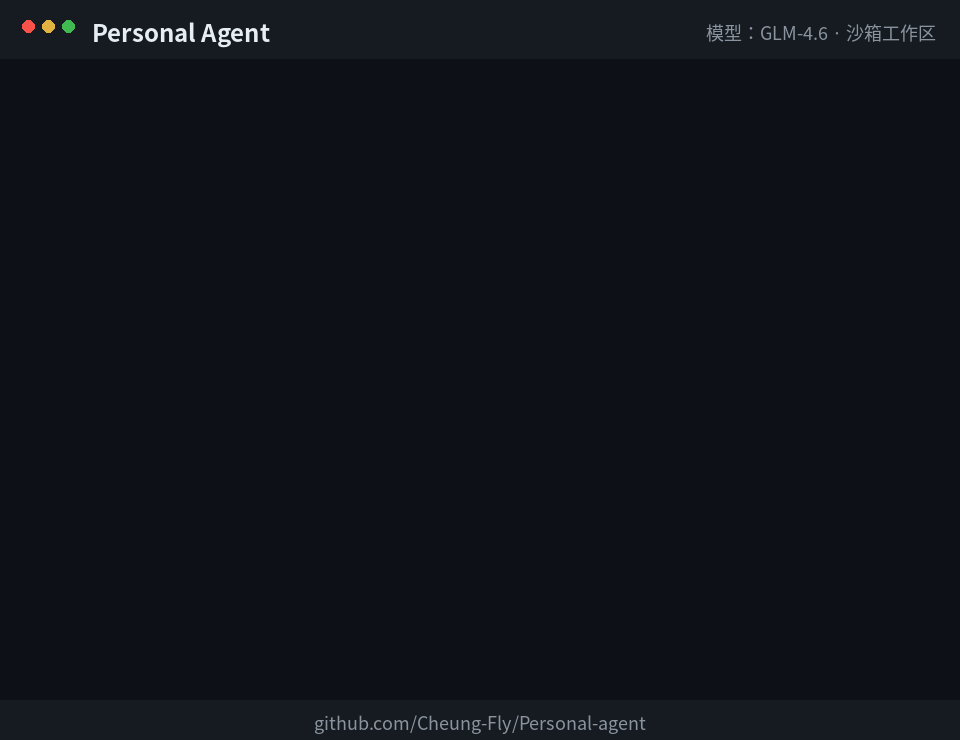

# Personal Agent

> A personal AI agent that lives on your own server — chat with it from the browser, and it writes code, runs commands, and automates multi-step tasks for you in a sandboxed workspace.
>
> 一个住在你自己服务器上的个人 AI Agent：在浏览器里和它对话，它就能在沙箱工作区里写代码、跑命令、完成多步自动化任务。

[](https://github.com/Cheung-Fly/Personal-agent/actions/workflows/ci.yml)


## 演示 / Demo



> 真实运行记录：Agent 写下 `hello.py`，第一次运行失败后自己换 `python3` 重试成功。
> Recorded from a real run: the agent writes `hello.py`, fails once, corrects itself, and succeeds.

## Why / 为什么做这个

Chatbots only talk. This project explores the agent pattern behind products like Muse:
an LLM that **decides**, a runtime that **orchestrates**, and tools that **act** — with sandboxing and human control in between.

普通聊天机器人只会说。这个项目复刻并拆解了 Muse 这类产品的 Agent 模式：大模型负责决策、编排层负责循环、工具层负责真正动手，三者之间有沙箱和权限兜底。

## Features / 功能

- **Web chat UI** — no build step, plain HTML/JS served by the backend / 零构建的网页聊天界面
- **Agent loop** — model → tool calls → results fed back → repeat, with a max-round guard / 模型与工具的多轮循环，带轮数上限防死循环
- **Server-side tools** — `list_files` / `read_file` / `write_file` / `exec_command` / 在服务器上读写文件、执行命令
- **Sandboxed workspace** — path-traversal protection, command timeout, output truncation / 路径沙箱校验、命令超时、输出截断
- **Model-agnostic** — any OpenAI-compatible API with tool calling (Muse / OpenAI / DeepSeek / Qwen…) / 任意支持 tool calling 的兼容接口，改配置即换模型
- **Persistent sessions (SQLite)** — refresh or restart and history is still there; server-generated session id, last 20 rounds loaded per request / 会话持久化：刷新、重启都不丢历史
- **Long-term memory (MEMORY.md)** — hand-written preferences injected as a second system message on every request; edit the file and the next message follows it / 长期记忆：手动写偏好，每次对话自动注入，改完下一句就生效
- **Approval tiers (v0.5)** — read-only tools auto-run, changes ask once on an approval card, dangerous calls are refused by default; every tool call is written to an audit log (`data/audit.log`) / 审批分级：只读自动、改动弹卡确认、高危默认拒绝，每次调用记审计日志
- **Access token auth** + Docker deployment, optional web VS Code (code-server) side-by-side / 口令鉴权、Docker 一键部署、可选网页版 VS Code

## Architecture / 架构

```
Browser (static/index.html)
    │  POST /api/chat
    ▼
Orchestrator (FastAPI, backend/main.py)  ──►  LLM API (external, decides only)
    │  agent loop: tool_call → execute → feed result back
    ▼
Tools (backend/tools.py)  ──►  Sandboxed workspace (agent_workspace/)
```

Full design notes: [docs/ARCHITECTURE.md](docs/ARCHITECTURE.md)（中文）

## Quick Start / 快速开始

**Docker (recommended / 推荐):**

```bash
git clone https://github.com/Cheung-Fly/Personal-agent.git
cd Personal-agent
cp .env.example .env   # fill in LLM_API_KEY / LLM_BASE_URL / LLM_MODEL / ACCESS_TOKEN
docker compose up -d --build
# open http://localhost:8000
```

**Local / 本地运行:**

```bash
cp .env.example .env
pip install -r requirements.txt
./start.sh             # http://localhost:8000
```

Check it's alive: `curl http://localhost:8000/health`

## Configuration / 配置 (.env)

| Key | Description |
|---|---|
| `LLM_API_KEY` | API key for your model provider / 模型 API 密钥（只放服务器，不要提交 Git） |
| `LLM_BASE_URL` | OpenAI-compatible base URL, e.g. `https://api.openai.com/v1` |
| `LLM_MODEL` | Model name that supports tool calling |
| `ACCESS_TOKEN` | Password for `/api/chat` — **set this before exposing the server** / 暴露到公网前必须设置 |
| `WORKSPACE_DIR` | Where the agent may work (default `./agent_workspace`) |
| `DATA_DIR` | Where the SQLite session DB lives (default `./data`, file `agent.db`) |
| `HISTORY_ROUNDS` | Most recent rounds loaded per request (default `20`) |
| `MEMORY_MAX_CHARS` | Long-term memory characters injected per request (default `2000`) |
| `APPROVAL_TIMEOUT_SECONDS` | How long an approval card waits before counting as denied (default `300`) |
| `MAX_TOOL_ROUNDS` | Agent loop limit (default `12`) |

## Security / 安全

- The agent can run shell commands **inside its workspace/container only**. Never expose it to the public internet without `ACCESS_TOKEN` + HTTPS (or keep it on a private network / VPN).
- API keys live in `.env`, which is git-ignored and docker-ignored.
- Roadmap: human approval for destructive actions, audit logging, command allow-list — **done in v0.5** (approval tiers + `data/audit.log`).

## Roadmap / 路线图

- [x] v0.1 Agent loop + sandboxed file/shell tools + web chat
- [x] v0.2 Streaming responses (SSE) with live tool logs
- [x] v0.3 Persistent sessions (SQLite)
- [x] v0.4 Long-term memory file (MEMORY.md injected as second system message)
- [x] v0.5 Approval tiers for tool calls (read-only auto, changes on a card, dangerous refused) + audit log
- [ ] MCP server for the tool layer; git & browser (Playwright) tools
- [ ] Desktop shell (Tauri)

## Project structure / 目录

```
personal-agent/
├─ backend/          # orchestrator (main.py) + tools (tools.py) + sessions (storage.py) + long-term memory (memory.py) + approval tiers (approval.py)
├─ static/           # web chat frontend
├─ agent_workspace/  # the only place the agent can touch (persisted volume)
├─ tests/            # tool-layer tests, no LLM required
├─ docs/             # architecture notes
├─ Dockerfile / docker-compose.yml
└─ .env.example
```

## Tests / 测试

```bash
pip install pytest
python -m pytest tests/ -q   # covers write/read/exec + sandbox path-traversal blocking
```

## License

MIT — see [LICENSE](LICENSE).
